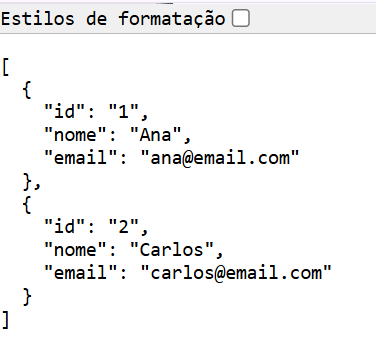
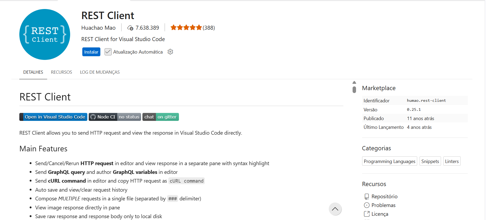

# 08-dwbe-node-json-server-phr

Material:

https://app.notion.com/p/O-que-uma-API-48544ced3625838681d6018cf5332031

https://app.notion.com/p/JSON-Server-a9044ced3625829f912781a3c0c55f3d

---

## Comandos Iniciais

```bash
sudo apt update
```

```bash
sudo apt install -y nodejs
```

```bash
node -v
```

```bash
npm install -g npm@11.19.0
```

```bash
npm -v
```

```bash
mkdir projeto
```

```bash
cd projeto
```

```bash
npm init -y
```

No arquivo `package.json`, substituir ` "type": "commonjs"` por ` "type": "module"`:

```text
{
  "name": "projeto",
  "version": "1.0.0",
  "description": "",
  "main": "index.js",
  "scripts": {
    "test": "echo \"Error: no test specified\" && exit 1"
  },
  "keywords": [],
  "author": "",
  "license": "ISC",
  "type": "module"
}
```

## Instalando o JSON Server

Instalação global:

```bash
npm install -g json-server
```

Ou no projeto:

```bash
npm install json-server
```

Caso seja instalado no projeto, observar as alterações no arquivo `package.json`:

```js
{
  "name": "projeto",
  "version": "1.0.0",
  "description": "",
  "main": "index.js",
  "scripts": {
    "test": "echo \"Error: no test specified\" && exit 1"
  },
  "keywords": [],
  "author": "",
  "license": "ISC",
  "type": "module",
  "dependencies": {
    "json-server": "^1.0.0-beta.15"
  }
}
```

## Criando o Projeto

Crie uma pasta `./projeto/db/`:

```bash
mkdir db
```

```bash
cd db
```

Crie o arquivo `./projeto/db/db.json`:

```bash
touch db.json
```

Informe o conteúdo abaixo no arquivo `./projeto/db/db.json`:

```js
{
  "usuarios": [
    {
      "id":1,
      "nome":"Ana",
      "email":"ana@email.com"
    },
    {
      "id":2,
      "nome":"Carlos",
      "email":"carlos@email.com"
    }
  ]
}
```

## Iniciando o Servidor

Execute:

```js
json-server --watch db.json
```
ou

```js
npx json-server --watch db.json 
(neste comando, ele executa localmente sem estar instalado globalmente)
```

Saída:

```text
$ json-server --watch db.json
--watch/-w can be omitted, JSON Server 1+ watches for file changes by default
JSON Server started on PORT :3000
Press CTRL-C to stop
Watching db.json...

♡( ◡‿◡ )

Index:
http://localhost:3000/

Static files:
Serving ./public directory if it exists

Endpoints:
http://localhost:3000/usuarios
```





# Alteração do Banco de Dados

Altere o conteúdo do arquivo `./projeto/db/db.json`, como informado abaixo:

```js
{
  "usuarios": [
    {
      "id":1,
      "nome":"Ana",
      "email":"ana@email.com"
    },
    {
      "id":2,
      "nome":"Carlos",
      "email":"carlos@email.com"
    }
  ],
  "tarefas": [
     {
       "id":1,
       "titulo":"Estudar API",
       "status":"Pendente"
     },
     {
       "id":2,
       "titulo":"Fazer exercício",
       "status":"Concluído"
     }
   ]
}
```

Nova saída:

```text
$ json-server --watch db.json
--watch/-w can be omitted, JSON Server 1+ watches for file changes by default
JSON Server started on PORT :3000
Press CTRL-C to stop
Watching db.json...

♡( ◡‿◡ )

Index:
http://localhost:3000/

Static files:
Serving ./public directory if it exists

Endpoints:
http://localhost:3000/usuarios

Endpoints:
http://localhost:3000/usuarios
http://localhost:3000/tarefas
```


---

## Cliente

Instalar a extensão `Live Server` do `VS Code`.

Criar a pasta `./projeto/public/`:

```bash
mkdir public
```

Criar o arquivo `./projeto/public/index.html`:

```html
<!DOCTYPE html>
<html lang="pt-br">

<head>
    <meta charset="UTF-8">
    <meta name="viewport" content="width=device-width, initial-scale=1.0">
    <title>API</title>
    <script src="app.js"></script>
</head>

<body>
    <div><button onclick="listarTarefas()">Buscar Tarefas</button></div>
    <br />

    <div>
        <input id="get-id-da-tarefa" placeholder="id"/>
        <button onclick="listarTarefaPorId()">Buscar Tarefa Por ID</button>
    </div>
    <br />

    <form>
        <input id="post-titulo-da-tarefa" type="text" placeholder="titulo">
        <input id="post-status-da-tarefa" type="text" placeholder="status">
        <button type="button" onclick="inserirTarefa()">Inserir Tarefa</button>
    </form>
    <br />

    <form>
        <input id="put-id-da-tarefa"type="text" placeholder="id">
        <input id="put-titulo-da-tarefa"type="text" placeholder="titulo">
        <input id="put-status-da-tarefa" type="text" placeholder="status">
        <button type="button" onclick="atualizarTarefa()">Atualizar Tarefa</button>
    </form>
    <br />

    <div>
        <input id="delete-id-da-tarefa" placeholder="id"/>
        <button onclick="excluirTarefa()">Exluir Tarefa</button>
    </div>
    <br />

    <div id="container"></div>
</body>

</html>
```

Criar o arquivo `./projeto/public/app.js`:

```js
async function listarTarefas() {
    const url = 'https://solid-spork-q79wg9gg79wrhwpj-3000.app.github.dev/tarefas';
    await fetch(url)
        .then((resposta) => resposta.json())
        .then((dados) => {
            imprimir(dados);
        });
}

async function listarTarefaPorId() {
    const id = document.getElementById("get-id-da-tarefa").value;

    const url = `https://solid-spork-q79wg9gg79wrhwpj-3000.app.github.dev/tarefas/${id}`;
    await fetch(url)
        .then((resposta) => resposta.json())
        .then((dados) => {
            imprimir(dados);
        });
}

async function inserirTarefa() {
    const titulo = document.getElementById("post-titulo-da-tarefa").value;
    const status = document.getElementById("post-status-da-tarefa").value;

    const url = 'https://solid-spork-q79wg9gg79wrhwpj-3000.app.github.dev/tarefas';
    await fetch(url, {
        method: "POST",
        headers: {
            "Content-Type": "application/json",
        },
        body: JSON.stringify({
            titulo: titulo,
            status: status
        }),
    });

    listarTarefas();
}

async function atualizarTarefa() {
    const id = document.getElementById("put-id-da-tarefa").value;
    const titulo = document.getElementById("put-titulo-da-tarefa").value;
    const status = document.getElementById("put-status-da-tarefa").value;

    const url = `https://solid-spork-q79wg9gg79wrhwpj-3000.app.github.dev/tarefas/${id}`;
    await fetch(url, {
        method: "PUT",
        headers: {
            "Content-Type": "application/json",
        },
        body: JSON.stringify({
            id: id,
            titulo: titulo,
            status: status,
        }),
    });

    listarTarefas();
}

async function excluirTarefa() {
    const id = document.getElementById("delete-id-da-tarefa").value;

    const url = `https://solid-spork-q79wg9gg79wrhwpj-3000.app.github.dev/tarefas/${id}`;
    await fetch(url, {
        method: "DELETE"
    });

    listarTarefas();
}

function imprimir(dados) {
    const container = document.getElementById('container');
    const tarefas = Array.isArray(dados) ? dados : [dados];

    container.innerHTML = "";

    if (tarefas.length === 0 || dados === null)
        return;

    const resp = tarefas.map((tarefa) => { return `<p>${JSON.stringify(tarefa)}</p>` }).join("");

    container.innerHTML = resp;
}
```

**OBS**:
> Na aba `Portas` do terminal, tornar a porta da aplicação `pública`.

## Porta

Para rodar em outra porta:

```bash
json-server --watch db.json --port 4000
```

## Usando Delay (simular Internet lenta). 

Muito útil para testes:

```bash
json-server --watch db.json --delay 2000
```

Delay:

```text
2000 ms = 2 segundos
```

## Paginação

Exemplo:

```
GET /usuarios?_page=1&_limit=5
```

---

## Filtro

```
GET /usuarios?nome=Ana
```

---

## Ordenação

```
GET /usuarios?_sort=nome&_order=asc
```

---

## Busca

```
GET /usuarios?q=ana
```

---

## Relacionamento entre dados

Exemplo:

```json
{
  "usuarios": [
    {
      "id":1,
      "nome":"Ana"
    }
  ],
  "tarefas": [
    {
      "id":1,
      "titulo":"Estudar",
      "usuarioId":1
    }
  ]
}
```

## Buscar tarefas de um usuário:

```
GET /tarefas?usuarioId=1
```

---

## Script no package.json (recomendado):

```json
{
  "scripts": {
    "api": "json-server --watch .db/db.json"
  }
}
```

Executar:

```bash
npm run api
```

---

## Estrutura recomendada de projeto

```text
projeto/
│
├── db/db.json
├── package.json
│
├── public/
│     index.html
│     app.js
│
└── README.md
```

## REST Client

No VS Code, instalar a extensão `REST Client`:




Criar o arquivo `teste.http`:

```text
# Isto é um comentário.
//Isto também é um comentário.

// Variável:
@url = https://solid-spork-q79wg9gg79wrhwpj-3000.app.github.dev

### Isto é um separador de requisições:
GET {{url}}/

### Isto é um separador de requisições:
GET {{url}}/usuarios

### Isto é um separador de requisições:
GET {{url}}/usuarios/1

### Isto é um separador de requisições:
GET {{url}}/tarefas

### Isto é um separador de requisições:
GET {{url}}/tarefas/1

### 
GET {{url}}/tarefas?_page=1&_per_page=2

### 
GET {{url}}/usuarios?nome=Ana

### Para ordenar de forma ascendente:
GET {{url}}/usuarios?_sort=nome

### Para ordenar de forma descendente, use um sinal de menos antes do campo:
GET {{url}}/usuarios?_sort=-nome

### Para buscar “ana” dentro do campo nome, use o operador contains, que ignora maiúsculas e minúsculas:
GET {{url}}/usuarios?nome:contains=ana
```

# Exercícios

Usando `JSON Server`, `HTML`, `CSS`, `JS` e a extensão `REST Client`, implemente um CRUD (CREATE, READ, UPDATE, DELETE) de:

1. Produtos de uma padaria. 

2. Eventos de uma agência de eventos. Estabeleça o relacionamento dos eventos com as atrações e cidades em que o evento ocorrerá.

3. Pacotes de viagem de uma agência de turismo. Estabeleça o relacionamento dos pacotes de viagem com as cidades de origem, cidades de destino e promoções.

